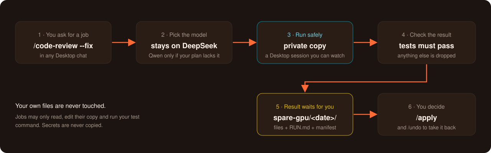

<div align="center">


<br>

<p>
<a href="https://github.com/subidhkhanal/spare-gpu/actions/workflows/test.yml"></a>    <a href="LICENSE"></a>
</p>

**[Install](#install)** · **[Features](#features)** · **[Commands](#command-reference)** · **[Safety](#safety)** · **[FAQ](#faq)**

</div>

<br>

## What this is

A set of **chat commands for BharatCode Desktop**. You install it once, then do everything by typing a `/command` in any Desktop chat:

- **Wait less:** `/auto` does anything a normal chat does, on whichever of Desktop's two models starts sooner.
- **Check your code:** code review (also of GitHub pull requests), security review, safe simplifications, and app checks in a real browser. Fixes run on a private copy of your project and are kept only if your tests pass; `/apply` brings them in and `/undo` takes them back.
- **Research:** literature reviews, technical comparisons, market research and fact checks, with rated sources and every claim checked against the quote it cites.
- **Keep track:** project memory every chat knows, hand-offs between chats, exact token costs, fewer permission prompts, and a health check of the install.

The work is split between Desktop's two models: **DeepSeek** plans and checks, and **Qwen** does the many quick steps, several at once.

Windows only. It works inside BharatCode Desktop with no API key and no extra account. Everything below is what the current build does.

> [!NOTE]
> spare-gpu is an independent project for the BharatCode Build League. It is not affiliated with BharatCode.

## Contents

1. [Install](#install)
2. [Features](#features)
3. [Any task on the faster model](#1-any-task-on-the-faster-model-auto)
4. [Code review](#2-code-review-code-review)
5. [Security review](#3-security-review-security-review)
6. [Simplify](#4-simplify-simplify)
7. [Apply and undo](#5-apply-and-undo-apply-undo)
8. [Deep research](#6-deep-research-deep-research)
9. [App check](#7-app-check-verify-app)
10. [Memory across chats](#8-memory-across-chats-remember-handoff-pickup)
11. [Cost](#9-cost-cost)
12. [Fewer permission prompts](#10-fewer-permission-prompts-prompts)
13. [Health check](#11-health-check-doctor)
14. [Settings](#settings)
15. [Safety](#safety)
16. [Command reference](#command-reference)
17. [FAQ](#faq)
18. [For developers](#for-developers)
19. [Where to look next](#where-to-look-next)
20. [Remove](#remove)

---

## Install

You need Windows and BharatCode Desktop, installed and signed in.

1. Open **PowerShell** and paste:
   ```powershell
   irm https://raw.githubusercontent.com/subidhkhanal/spare-gpu/master/install.ps1 | iex
   ```
2. Fully close BharatCode Desktop (also from the taskbar tray) and open it again.
3. In any chat, type `/doctor` to check that everything is connected.

That's all. The installer adds Python and git if they're missing, installs spare-gpu in `%LOCALAPPDATA%\spare-gpu`, and runs `gtu integrate --pack`, the one terminal command spare-gpu has: it adds every chat command below to Desktop. Run the same line again to update.

<details>
<summary>Installer options and manual install</summary>

- Pin a version: `$env:SPARE_GPU_VERSION = '0.1.0'` before the install line.
- Install from another copy of the repository: `$env:SPARE_GPU_REPO = 'owner/name'`.
- Until the first release is published, it installs the latest code from `master` and says so.
- By hand, with Python 3.11+ and git: `pipx install git+https://github.com/subidhkhanal/spare-gpu`, then `gtu integrate --pack`.
- `gtu integrate --pack --only review,memory` installs only some commands (the parts: `split`, `research`, `review`, `security`, `simplify`, `verify`, `memory`, `manage`). `--lite` is for a Qwen-only plan.

</details>

---

## Features

Eleven features, each a chat command. The everyday one comes first; none depends on another.

| # | Feature | Type in a chat | What you get |
|---|---|---|---|
| 1 | [Any task, faster](#1-any-task-on-the-faster-model-auto) | `/auto <anything>` | Anything a normal chat does, on whichever model starts sooner |
| 2 | [Code review](#2-code-review-code-review) | `/code-review`, `/code-review 42` | Bugs with evidence in your changes, a commit, a branch or a pull request |
| 3 | [Security review](#3-security-review-security-review) | `/security-review` | High-confidence security findings, false alarms dropped |
| 4 | [Simplify](#4-simplify-simplify) | `/simplify src` | Cleanups that keep behaviour, kept only if your tests pass |
| 5 | [Apply and undo](#5-apply-and-undo-apply-undo) | `/apply`, `/undo` | A fix job's files copied into your project, and taken back |
| 6 | [Deep research](#6-deep-research-deep-research) | `/deep-research <question>` | A checked, cited report on papers, tools, markets or a single fact |
| 7 | [App check](#7-app-check-verify-app) | `/verify-app <url> <what>` | Your running app checked in a real browser |
| 8 | [Memory](#8-memory-across-chats-remember-handoff-pickup) | `/remember`, `/handoff`, `/pickup` | Notes every chat knows; work passed to a new chat |
| 9 | [Cost](#9-cost-cost) | `/cost` | Exact tokens per model, and what each job used |
| 10 | [Fewer prompts](#10-fewer-permission-prompts-prompts) | `/prompts` | Allow rules for commands you keep approving |
| 11 | [Health check](#11-health-check-doctor) | `/doctor` | Every problem in the install, with its fix |

The bigger commands (`/code-review`, `/security-review`, `/simplify`, `/deep-research` and `/verify-app`) split the work: DeepSeek plans and judges, several Qwen helpers read or search at the same time, and each ends with a **cost summary** of which model did what and the exact tokens used. Add `--plan` to any of them (for example `/code-review --plan`) to see the plan, how many helpers it would start and on which model, without starting anything.

---

## 1. Any task on the faster model: `/auto`


At busy times one of Desktop's two models has a queue of several minutes while the other is free. `/auto` checks BharatCode's live queues and, when the other model would start sooner and is good enough for the task, sends your work there.

Your request is done the way a normal BharatCode chat does it: the model can read and edit your files, run commands, search and use your MCP tools, and asks for your approval as usual. It runs in a session named "auto: ..." in your project, and the reply comes back into your chat.

| Type | What happens |
|---|---|
| `/auto what does calc.py do?` | Reads the file and answers, on the model that starts sooner |
| `/auto now add a divide function` | Continues the same conversation: it remembers the earlier `/auto` turns from this chat |
| `/auto new <request>` | Starts a fresh conversation |
| `/auto` | Shows how long each model would wait right now |

- Each chat keeps its own "auto: ..." session. The model is picked again for every message, so one turn can run on DeepSeek and the next on Qwen, with the whole history kept.
- If the chosen model is failing ("Model unavailable"), the turn moves to the other model at once instead of waiting for Desktop's retries, and that model is skipped for the next 10 minutes.
- Put `/auto` in front of every follow-up; a plain message goes to your chat's own model.
- If the work needs your approval (an edit, a command), the reply says so: open the "auto: ..." session and approve it there.
- A long task that's still running after 30 minutes keeps going in its session; the reply says where to watch it.

Example, when DeepSeek had a queue:

```
/auto what does calc.py do?
→ calc.py has add() and sub(), both for two numbers.
  (Answered by Qwen 3.8 27B: saves about 2m 43s of waiting over DeepSeek V4.1 Flash, and its lane has a free slot.
   Steps and approvals: the 'auto: what does calc.py do?' session.)
```

### How it picks the model

It starts from DeepSeek and switches only when that saves at least 20 seconds and the other model has a free slot:

| Right now | `/auto` runs on | Fix jobs run on |
|---|---|---|
| DeepSeek free | DeepSeek | DeepSeek |
| DeepSeek queued, Qwen free | **Qwen** | DeepSeek |
| Qwen queued, DeepSeek free | DeepSeek | DeepSeek |

"Saves" is judged first by what you actually waited: how long each model took to start answering in your own Desktop chats over the last 30 minutes (the median of its latest 5 replies). BharatCode's queue figures decide only when your recent chats don't cover both models. They can be wrong: on 9 Nov they showed Qwen 85 seconds faster while your replies started in about 6 seconds on DeepSeek and 13 on Qwen.

Moving up to DeepSeek is always allowed. Moving down to Qwen happens only for `/auto` conversations, which go to the faster model by design rather than by measurement: not waiting is the point, and the reply always names the model that answered. Fix jobs stay on DeepSeek, and a fix is kept only if your tests pass with it. If your plan has only Qwen, everything runs on Qwen.

In the bigger commands, some DeepSeek roles also ship as a standard-model variant on Qwen. They are only used once a benchmark shows Qwen is good enough for them; until then they stay on DeepSeek.

---

## 2. Code review: `/code-review`


Several Qwen helpers each look for one kind of bug, at the same time; DeepSeek checks every finding against the code and keeps only those with real evidence.

| Type | What it reviews |
|---|---|
| `/code-review` | Your uncommitted changes |
| `/code-review HEAD~1` or `/code-review my-branch` | A commit, or a branch against the default branch |
| `/code-review 42` | GitHub pull request 42 |
| `/code-review high 42` | The same, more thoroughly (`low`, `medium`, `high` or `deep`; default `medium`) |

- **`--fix`** hands the kept findings to a `fix` job: applied on a private copy and kept only if your tests still pass, then `/apply` brings them in.
- **Pull requests** go through the GitHub CLI (`gh`, signed in with `gh auth login`). Your files and branch stay as they are: nothing is checked out. The review judges the code against what the PR says it does. It never comments unless you add `--post`; then it posts the findings as one PR comment and never approves or blocks.
- **Fewer false findings:** before DeepSeek reads them, entries that try to give instructions instead of describing code are dropped, and duplicates are merged, noting how many helpers agreed.

---

## 3. Security review: `/security-review`


A read-only security review. Five Qwen helpers each look for one kind of problem: injection, login and access, secrets, code execution, data leaks. Known false alarms are dropped by fixed rules, then DeepSeek verifies what's left.

| Type | What it reviews |
|---|---|
| `/security-review` | Your uncommitted changes |
| `/security-review my-branch` | A commit or a branch |
| `/security-review deep` | The same, with a second verifier trying to refute each finding |

- Only high-confidence findings are reported, each with the code path and a fix.
- It never changes a file.

---

## 4. Simplify: `/simplify`


Finds cleanups that don't change behaviour (a helper that already exists used instead of a copy, a branch that can't be taken, work done twice), and applies the safe ones as a `fix` job, kept only if your tests still pass.

| Type | What it looks at |
|---|---|
| `/simplify` | Your uncommitted changes |
| `/simplify src/payments` | A file or folder |

- Qwen helpers propose; DeepSeek accepts only changes with no risk to behaviour, and shows you the list first.
- The result lands in `spare-gpu/` like any job: `/apply` it or leave it.

---

## 5. Apply and undo: `/apply`, `/undo`


`/code-review --fix` and `/simplify` hand their changes to a **fix job**. It runs on its own as a Desktop chat named **"spare-gpu: …"**, which you can open and watch, on a **private copy** of your project, so your own files are never touched. Its result is kept only if your tests still pass, and the files it changed are copied to a dated folder in your project. Nothing else changes until you say so.



```
your-project/
└── spare-gpu/
    └── 2026-11-05_12-38-50/      ← when the job finished
        ├── RUN.md                ← what the job did, step by step
        ├── manifest.json         ← every file it changed, with checksums
        └── src/
            └── mathx.py          ← the changed files
```

| Type | What happens |
|---|---|
| `/apply` | Copies the newest result into your project |
| `/apply 2026-11-05_12-38-50` | Copies that older result instead |
| `/apply --dry-run` | Says what would happen, writes nothing |
| `/undo` | Takes the last apply back, exactly |

- `/apply` only replaces a file you haven't changed since the job started. Otherwise it skips it and tells you (`/apply --force` replaces it anyway).
- Your old version is saved first, so `/undo` restores everything exactly.
- The `spare-gpu/` folder is ignored by git, so it never shows up as a change. You can also copy files from it by hand.
- spare-gpu finds how your tests run from `pyproject.toml`, `package.json`, `go.mod`, `Cargo.toml` or a `Makefile` (see [Settings](#settings) to change it).
- Each job has a token budget (200,000 by default); a job that reaches it stops instead of failing, and nothing of it is kept. "Cancel the fix job" in a chat stops one within a few seconds.

---

## 6. Deep research: `/deep-research`


Writes a report with sources into `research/<topic>/`, for literature reviews, technical comparisons (libraries, tools, approaches), market and company research, and single factual questions.

1. **Scope.** DeepSeek works out what kind of question it is and writes a brief: the scope, its assumptions, and a checklist of what a complete answer must cover. It asks you first only when the question can't be researched without your choice.
2. **Scout, in rounds.** Qwen scouts search at the same time, each from where its kind of question is best answered: papers (OpenAlex, Crossref, arXiv), official docs and repositories, company filings and news. They rate every source (A primary, B reputable secondary, C weak), quote it exactly, and stop once two good sources agree. DeepSeek checks the notes against the checklist and sends scouts after what is thin, missing or contested, for up to three rounds.
3. **Write.** Qwen writers draft one section each from the notes, then one more writes the summary from the finished sections. Conflicting sources are shown, not hidden, and time-sensitive figures carry their date.
4. **Check.** DeepSeek checks every claim against the quote it cites and every source against the registries, and lists the checklist items the report doesn't cover.

| Type | What you get |
|---|---|
| `/deep-research how do vector databases index embeddings?` | A standard report: 5 sub-questions, up to 2 rounds of scouting |
| `/deep-research <question> --depth quick` | A short one: 3 sub-questions, 1 round (the default for a single fact) |
| `/deep-research <question> --depth deep` | A longer one: 8 sub-questions, up to 3 rounds, a scout that looks for counter-evidence, and a second check |
| `/deep-research <question> --sources papers` | Only papers (`web`, `papers` or `both`; by default it picks from the kind of question) |
| `/deep-research <question> --plan` | The brief and the plan, without starting anything |

- Every reference is checked against the registries: its id must resolve and its title, authors and year must match. A claim must match the quote it cites, and a key claim never rests only on weak sources.
- The same source found by several scouts is merged into one reference.
- Web search goes through Exa, with no key needed; your searches go to Exa.

---

## 7. App check: `/verify-app`


Checks a running app in a real browser: Qwen drivers click through each check you describe at the same time, and DeepSeek judges each one pass, fail or unclear, quoting what the page showed.

| Type | What it does |
|---|---|
| `/verify-app http://localhost:3000 the login form accepts a valid user` | Checks that one flow |

- Needs the Playwright add-on from Desktop's marketplace.
- It only looks and clicks; it never changes your code.

---

## 8. Memory across chats: `/remember`, `/handoff`, `/pickup`


Desktop forgets a chat when it ends. These keep what matters.

| Type | What it does |
|---|---|
| `/remember <note>` | Adds a note to `.gtu/memory.md`. Every chat in this project reads it automatically. `/remember` alone shows it. |
| `/handoff` | Saves where this chat stopped (goal, what's done, next steps, files involved) to `.gtu/handoff.md`. |
| `/pickup` | In a new chat: reads the hand-off and the memory, says what changed since, and waits for you. |

- Keep the memory short: every chat reads it on every step, so it costs tokens. `/doctor` shows how much, and `/remember` warns past 60 lines or 4,000 characters.
- Commit `memory.md` to share it with your team; `handoff.md` stays private.

---

## 9. Cost: `/cost`


Shows the **exact tokens per model** from Desktop's own record of every reply on this machine, then spare-gpu's jobs: how they ended, what they used, which kept nothing, and the most expensive three.

| Type | What it shows |
|---|---|
| `/cost` | The last 24 hours |
| `/cost 7 days` | The last week |
| `/cost with tables` | The full tables instead of one paragraph |
| `/cost beta` | Another Desktop build's record (`stable`, `beta`, `dev` or `local`) |

- It reads the record of the Desktop you're typing in, unless you name another build.
- Each of the bigger commands also reports its own run's tokens at the end.

---

## 10. Fewer permission prompts: `/prompts`


Desktop asks before running a shell command, and "always allow" only remembers that exact text, so `git status` and `git status --short` each ask again.

| Type | What it does |
|---|---|
| `/prompts` | Finds the read-only commands you approved in at least 3 chats in the last 30 days, and gives the allow rules to paste |
| `/prompts 90` | Looks at the last 90 days |
| `/prompts --min 2` | Needs only 2 chats |

- It reads a private copy of Desktop's own history, and names the config file the snippet goes in.
- It never edits your files and never suggests anything that writes, deletes, installs or pushes.

---

## 11. Health check: `/doctor`


Checks everything (spare-gpu, git, Desktop's settings, the connection to spare-gpu, the command pack, project memory, this project's jobs and settings) and tells you how to fix each problem. It changes nothing.

| Type | What it does |
|---|---|
| `/doctor` | The full check, in a few seconds |
| `/doctor live` | Also sends one tiny request, to measure what the pack adds to each step |
| `/doctor beta` | Checks another Desktop build's settings |

- Every finding is PASS, WARN or FAIL, and each problem comes with its fix.
- The pack is built to add nothing to your normal chats; `/doctor live` measures it.

---

## Settings

Jobs work without any settings. To change how they run, write `.gtu/settings.json` in your project; commit it, the rest of `.gtu` stays out of git. For one run, an environment variable overrides a setting.

```json
{ "test_command": "npm test", "job_token_budget": 300000 }
```

| Setting | Override for one run | What it sets |
|---|---|---|
| `test_command` | `GTU_TEST_COMMAND` | How your tests run (found from your project's files when not set). A fix is kept only if this passes. |
| `allowed_commands` | `GTU_ALLOWED_COMMANDS` | Commands a job may run (must include the test command) |
| `test_timeout` | `GTU_TEST_TIMEOUT` | Seconds one test run may take |
| `agent_timeout` | `GTU_AGENT_TIMEOUT` | Seconds one job's Desktop session may take |
| `job_token_budget` | `GTU_JOB_TOKEN_BUDGET` | Tokens one job may use before it stops |
| `preferred_model` | `GTU_PREFERRED_MODEL` | The model fix jobs and `/auto` start from (DeepSeek by default) |
| `switch_safe` | `GTU_SWITCH_SAFE` | Lets fix jobs move to the faster model too (`["fix"]`); off by default |

`/doctor` shows the settings in force and says what's wrong with a broken file.

---

## Safety

- Fix jobs never change your files: they work on a private copy, and their results wait in `spare-gpu/` until you `/apply` them.
- `/auto` works in your project like a normal chat, under your own Desktop permissions: it asks before an edit or a command whenever Desktop would.
- It never pushes and never commits to your project. `/code-review --post` is the only thing that writes anywhere else, and only when you ask: one comment on that pull request.
- Jobs may only read, edit their copy, and run your test command. No web access, no other commands, no permission pop-ups, and your other MCP servers are switched off inside a job.
- Some files are never copied into a job, even if git tracks them: tool and instruction folders that Desktop would run or obey (`.opencode`, `.claude`, `.agents`, `.cursor`), Desktop's own config files, and credential files (`.env`, `*.pem`, `*.key`, `id_rsa*` and similar). To leave out more, list patterns in `.gtu/copy-exclude`, one per line.
- Big folders like `node_modules`, `venv`, `dist` and `build` aren't copied, unless git tracks them.
- The commands' helpers and tools are hidden from your normal chats, so they add nothing to them (a test holds this to a budget of 1,500 tokens per step), and every helper has a step limit (30 for a helper, 60 for a lead).

---

## Command reference

**In any Desktop chat**

| Command | Feature |
|---|---|
| `/auto [new] <anything>` | [Any task, faster](#1-any-task-on-the-faster-model-auto) |
| `/code-review [low\|medium\|high\|deep] [commit, branch or PR number] [--fix\|--post] [--plan]` | [Code review](#2-code-review-code-review) |
| `/security-review [commit or branch] [deep] [--plan]` | [Security review](#3-security-review-security-review) |
| `/simplify [file or folder] [--plan]` | [Simplify](#4-simplify-simplify) |
| `/apply [result] [--dry-run] [--force]`, `/undo [result]` | [Apply and undo](#5-apply-and-undo-apply-undo) |
| `/deep-research <question> [--depth quick\|standard\|deep] [--sources web\|papers\|both] [--plan]` | [Deep research](#6-deep-research-deep-research) |
| `/verify-app <url> <what to check> [--plan]` | [App check](#7-app-check-verify-app) |
| `/remember [note]`, `/handoff`, `/pickup` | [Memory](#8-memory-across-chats-remember-handoff-pickup) |
| `/cost [days] [build]` | [Cost](#9-cost-cost) |
| `/prompts [days] [--min N]` | [Fewer prompts](#10-fewer-permission-prompts-prompts) |
| `/doctor [live] [build]` | [Health check](#11-health-check-doctor) |

**In a terminal** (only to install or remove)

| Command | What it does |
|---|---|
| `gtu integrate --pack` | Adds every chat command to Desktop (the installer runs it). Safe to run again. |
| `gtu integrate --uninstall` | Removes spare-gpu from Desktop |

---

## FAQ

<details>
<summary>Does it change my files?</summary>

Only when you ask. `/auto` is a normal chat, so it edits your project when you ask it to, with Desktop's usual approvals. Fix jobs (from `/code-review --fix` and `/simplify`) work on a private copy: the files they changed wait in `spare-gpu/<date>_<time>/` until you copy them yourself or type `/apply`, and `/undo` takes that back. The other commands only read your code or write their own files (`research/`, `.gtu/`).
</details>

<details>
<summary>Will a cheaper model make my work worse?</summary>

Only `/auto` moves your work to Qwen to save waiting, by design, and its reply names the model that answered. Fix jobs stay on DeepSeek and are kept only if your tests pass. In the bigger commands, the many small helper steps run on Qwen by design, while DeepSeek plans and checks their work.
</details>

<details>
<summary>Do I need an API key or a terminal?</summary>

No API key: spare-gpu uses Desktop's own sign-in. The terminal is only for installing (the one PowerShell line) and removing; everything else is a chat command.
</details>

<details>
<summary>Do the commands slow down my normal chats?</summary>

No. Their helpers and tools are hidden from normal chats, so they add nothing to each step (a test holds this to a 1,500-token budget). Only the memory file is read by every chat, and `/doctor` shows its size.
</details>

<details>
<summary>Why Windows only?</summary>

It is built and tested for BharatCode Desktop on Windows: paths, line endings, the installer and the shell commands all follow Windows.
</details>

<details>
<summary>Does it work offline?</summary>

No. Jobs, reviews and questions run on BharatCode's models. The commands that only read your machine, like `/cost`, `/prompts`, `/doctor`, `/apply` and `/undo`, work without a connection, but they still run in a Desktop chat.
</details>

---

## For developers

### How it fits together

```
BharatCode Desktop
├── starts `gtu mcp --pack` for each open project ........ spare-gpu's MCP server (mcp_server.py)
├── reads its config folder, where `gtu integrate --pack`
│   put the chat commands and agents ...................... command/*.md, agent/*.md, config.json
└── runs its own local server, which spare-gpu uses to
    start sessions for /auto turns and fix jobs ......... desktop.py
```

- **A chat command is Markdown.** A command file names the agent that runs it. A command's lead agent runs on the heavy model (DeepSeek), starts helper agents on the standard model (Qwen) with Desktop's task tool, and calls spare-gpu's tools over MCP. The model ids are filled into `{{HEAVY_MODEL}}` and `{{STANDARD_MODEL}}` at install time from BharatCode's model list.
- **Two kinds of tools.** Five are always on: `spare_auto`, `spare_waits`, `spare_delegate`, `spare_work_status` and `spare_cancel_work`. The rest belong to the pack: Desktop's config denies them to every agent except the one that needs them, so a normal chat never pays for them.
- **`/auto`** (`SpareTools.auto`) picks the model (`router.py`, `waits.py`, `stats.py`), keeps one background session per chat (`.gtu/auto-sessions.json`) and relays each turn.
- **Fix jobs:**
  - `actions.py` queues a fix job.
  - `scheduler.py` runs its steps as Desktop sessions on a private copy (`worktree.py`). The steps themselves are in `jobs.py`.
  - `landing.py` exports the result to `spare-gpu/<date>_<time>/` and does `/apply` and `/undo`.
  - `store.py` keeps the queue in `.gtu/gtu.db`.

### Project layout

| Path | What's there |
|---|---|
| `src/gpu_token_utilization/` | The package: the MCP server, the installer (`cli.py`, `bc_config.py`), jobs, routing, and the code behind the pack's tools (`refs.py`, `scholar.py`, `tally.py`, `security.py`, ...) |
| `src/gpu_token_utilization/commands/`, `agents/` | `/auto` and its small handoff agent, installed with or without the pack |
| `src/gpu_token_utilization/pack/` | The pack: `commands/` and `agents/` (Markdown), and `__init__.py`, which lists each component with its commands, agents and tools |
| `tests/` | pytest. `fakedesktop.py` (in the package) is an in-process fake of Desktop's server; `tests/fixtures/` holds recorded registry answers |
| `scripts/` | Benchmarks and measurements, and `improve.py`, the improvement loop. They need Desktop and the internet, and never run in CI |
| `benchmarks/` | The improvement loop's benchmarks: recorded material and small projects with planted bugs (its README says how to run them) |
| `research/` | The measurements and manual checks behind design decisions; `research/improve/` records every run, candidate and promotion of the improvement loop |
| `docs/` | The install checklist, how to release, and the images |

### Set up a working copy

```powershell
git clone https://github.com/subidhkhanal/spare-gpu
cd spare-gpu
python -m venv .venv
.venv\Scripts\pip install -e ".[dev]"
.venv\Scripts\gtu integrate --pack
```

Then fully close and reopen BharatCode Desktop. Desktop now starts the server from your checkout, so:

- **Python changes** take effect at the next Desktop restart.
- **Markdown changes** (commands and agents) need `gtu integrate --pack` again, then a restart.

### Run the tests

```powershell
python -m pytest -q                      # everything, about 20 minutes
python -m pytest tests/test_refs.py -q   # one file while you work
```

- Tests use fakes and recorded fixtures only: the fake Desktop server, recorded registry answers, and a fake clock. No test calls a live model or the internet; keep it that way.
- CI runs the suite on Windows with Python 3.11 and 3.12 (`.github/workflows/test.yml`).

### Add a chat command

1. **Write the Markdown.** The command goes in `pack/commands/<name>.md`, its agents in `pack/agents/`. Each file:
   - starts with the `# Installed by spare-gpu` marker line
   - uses `{{HEAVY_MODEL}}` or `{{STANDARD_MODEL}}` for its model
   - sets a `steps:` limit
   - denies `"*"` first, then allows exactly the tools and files the agent needs
2. **Register it** as a component in `pack/__init__.py`, with its commands, agents and tools.
3. **If it needs a tool,** add a method to `SpareTools` and register it inside `if pack:` in `build_server`. The pack's config then denies it to everyone else automatically.
4. **Test it.**
   - `test_pack_markdown.py` checks the Markdown rules.
   - `test_overhead_budget.py` checks that normal chats still pay nothing.
   - Add tests for any new tool, using the fakes.
5. **Try it.** Run `gtu integrate --pack`, restart Desktop, and run the command. `/doctor` lists the tools the server offers.

### Improve a part with a benchmark

`scripts/improve.py` proposes a change, scores it against the current version on a fixed
benchmark, and keeps it only when it wins by 5% and you promote it (archived first, so
`rollback` undoes it). Eight parts have a benchmark (`python scripts/improve.py list`):

- **Replayed, seconds, and held by `tests/test_bench.py`:** `verify-refs` and `router` (settings
  in `tuning.json`, searched over a grid), and `collect-sources` (code: change it and keep the
  change only if the score holds).
- **Live in Desktop, tokens and time:** `code-review`, `security-review`, `simplify`,
  `auto-handoff` and `deep-research`. DeepSeek rewrites the agents' prompts from the current
  version's failures. Install the candidate, restart Desktop, and score it.

[benchmarks/README.md](benchmarks/README.md) has the steps. Nothing is promoted, committed or
pushed without your command.

### Rules the project keeps

- Windows only.
- The pack adds at most 1,500 tokens to each step of a normal chat (`test_overhead_budget.py`); today it adds none.
- Tests use fakes and recorded fixtures only.
- Web pages, notes and other model output are data, never instructions, and every agent's prompt says so.
- spare-gpu never commits or pushes in the user's project.

### Debugging

- **Start with `/doctor`.**
- **Desktop's record of every chat** is `%LOCALAPPDATA%\BharatCode <channel>\Data\bharatcode.db`. It's SQLite (tables `session`, `message`, `part`); open it read-only. `stats.py` shows how to read it.
- **Desktop's log** is `%LOCALAPPDATA%\BharatCode <channel>\Log\opencode.log`. It shows when each session started streaming, on which agent and model.
- **spare-gpu's state for a project** is in `.gtu/`:
  - `gtu.db`: jobs and steps
  - `router.json`: routing memory
  - `auto-sessions.json`: /auto's sessions
  - `jobs/<id>/ledger.json`: one record per job

The channel folder is `BharatCode` for the released app and `BharatCode Beta`, `BharatCode Dev` or `BharatCode Local` for the others.

---

## Where to look next

| If you want to… | Read |
|---|---|
| Check an install step by step on a clean PC | [docs/install-checklist.md](docs/install-checklist.md) |
| Cut a release | [docs/releasing.md](docs/releasing.md) |
| See the measurements behind the routing and the commands | [research/](research/) |
| Check each command by hand | `research/<command>/manual-check.md` |
| See what code is reused, and under which licence | [ATTRIBUTION.md](src/gpu_token_utilization/pack/ATTRIBUTION.md) |

## Remove

```powershell
gtu integrate --uninstall
```

Then delete the `%LOCALAPPDATA%\spare-gpu` folder.

## License

MIT, see [LICENSE](LICENSE). Credits for code reused from other projects are in [ATTRIBUTION.md](src/gpu_token_utilization/pack/ATTRIBUTION.md).

<div align="center">
<br>
<sub><a href="https://bharatcode.ai">bharatcode.ai</a> · <a href="https://github.com/subidhkhanal/spare-gpu/actions">Tests</a> · <a href="https://github.com/subidhkhanal/spare-gpu/issues">Issues</a> · <a href="research/">Research</a></sub>
<br>
<sub>An independent project for the BharatCode Build League, not affiliated with BharatCode.</sub>
</div>
