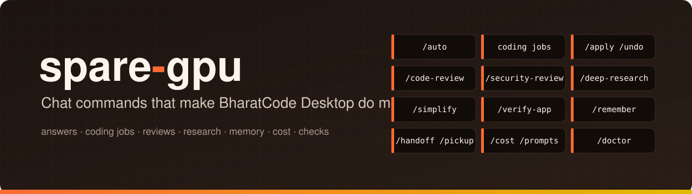
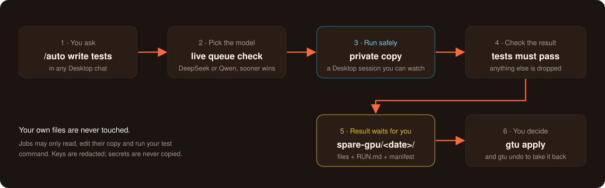

<div align="center">



<br>

<p>
<a href="https://github.com/subidhkhanal/spare-gpu/actions/workflows/test.yml"></a>    <a href="LICENSE"></a>
</p>

**[Install](#install)** · **[Overview](#overview)** · **[How it works](#how-it-works)** · **[Commands](#command-reference)** · **[FAQ](#faq)**

</div>

<br>

## What this is

A toolkit that plugs into **BharatCode Desktop** and makes it do more, faster:

- **Less waiting.** When one model has a queue and the other is free, your work goes to the free one.
- **Coding jobs you can trust.** Tests, docs, reviews and fixes run on a private copy of your project, and are kept only if they pass their checks.
- **Bigger commands.** Code review, security review, deep research and more, split between the two models so each does what it's best at.
- **Memory and cost.** Notes every chat knows, hand-offs between chats, and exact token figures.

Windows only. It works inside BharatCode Desktop with no API key and no extra account. Everything below is what the current build actually does.

> [!NOTE]
> spare-gpu is an independent project for the BharatCode Build League. It is not affiliated with BharatCode.

## Contents

1. [Install](#install)
2. [Overview](#overview)
3. [Faster answers: `/auto`](#faster-answers-auto)
4. [Coding jobs](#coding-jobs)
5. [Results: apply and undo](#results-apply-and-undo)
6. [Command pack](#command-pack)
7. [Memory across chats](#memory-across-chats)
8. [Cost](#cost)
9. [Fewer permission prompts](#fewer-permission-prompts)
10. [Git hooks](#git-hooks)
11. [Settings](#settings)
12. [Checking your install](#checking-your-install)
13. [Safety](#safety)
14. [Command reference](#command-reference)
15. [Good to know](#good-to-know)
16. [FAQ](#faq)
17. [Where to look next](#where-to-look-next)
18. [Remove](#remove)

---

## Install

You need Windows and BharatCode Desktop, installed and signed in.

1. Open **PowerShell** and paste:
   ```powershell
   irm https://raw.githubusercontent.com/subidhkhanal/spare-gpu/master/install.ps1 | iex
   ```
2. Fully close BharatCode Desktop (also from the taskbar tray) and open it again.
3. In each project you use it in, run `gtu init` once (see [Settings](#settings)).
4. Optional: `gtu integrate --pack` adds the [command pack](#command-pack). Restart Desktop again after it.

The installer adds Python and git if they're missing, installs spare-gpu in `%LOCALAPPDATA%\spare-gpu`, and connects it to Desktop. Run the same line again to update.

<details>
<summary>Installer options and manual install</summary>

- Pin a version: `$env:SPARE_GPU_VERSION = '0.1.0'` before the install line.
- Install from another copy of the repository: `$env:SPARE_GPU_REPO = 'owner/name'`.
- Until the first release is published, it installs the latest code from `master` and says so.
- By hand, with Python 3.11+ and git: `pipx install git+https://github.com/subidhkhanal/spare-gpu`, then `gtu integrate`.

</details>

---

## Overview

| Feature | How you use it | What it does |
|---|---|---|
| [Faster answers](#faster-answers-auto) | `/auto <request>` | Runs it on whichever model starts sooner |
| [Coding jobs](#coding-jobs) | `/auto write tests for src`, `gtu add` | Tests, docs, reviews, fixes, "make the tests pass", "implement a plan", each on a private copy |
| [Apply and undo](#results-apply-and-undo) | `gtu apply`, `gtu undo` | Copies a job's result into your project, and takes it back |
| [Command pack](#command-pack) | `/code-review`, `/security-review`, `/deep-research`, `/simplify`, `/verify-app` | Bigger tasks split between DeepSeek (plans, checks) and many Qwen helpers |
| [Memory](#memory-across-chats) | `/remember`, `/handoff`, `/pickup` | Notes every chat knows, and passing work to a new chat |
| [Cost](#cost) | `gtu cost`, `/cost` | Exact tokens per model, and what each job used |
| [Fewer prompts](#fewer-permission-prompts) | `gtu prompts` | Suggests allow rules for commands you keep approving |
| [Git hooks](#git-hooks) | `gtu hooks install` | Blocks commits with keys, reviews each commit |
| [Settings](#settings) | `gtu init` | Saves how your tests run and other project settings |
| [Checks](#checking-your-install) | `gtu doctor` | Finds problems in your install and says how to fix each |

### How it works



1. **You ask** in any Desktop chat, with `/auto` or in plain words.
2. **spare-gpu checks BharatCode's live queues** and picks the model that starts sooner, if it's good enough for the task.
3. **The job runs as its own Desktop session** on a private copy of your project. You can open it and watch.
4. **The result is checked:** tests must pass, docs may not change code. Anything that fails the check is dropped.
5. **Kept files wait in `spare-gpu/<date>/`**, with a `RUN.md` and a `manifest.json`.
6. **You decide:** copy what you want, or `gtu apply` (and `gtu undo` to take it back).

---

## Faster answers: `/auto`

BharatCode Desktop gives you two models: **DeepSeek** (stronger) and **Qwen** (faster to get). At busy times one of them has a queue of several minutes while the other is free. spare-gpu checks BharatCode's live queues and, when the other model would start sooner and is good enough for the task, sends your work there.

Type `/auto` and what you want:

| You type | What happens |
|---|---|
| `/auto what does a race condition mean?` | Answers in the chat, on the faster model |
| `/auto write tests for src/payments.py` | Writes tests and keeps only the ones that pass |
| `/auto write docs for src/utils.py` | Adds docstrings and README text without changing code |
| `/auto review src/router.py` | Writes a code review |
| `/auto make the tests pass` | Changes the code until your tests pass, in up to 3 tries. It never changes the tests. |
| `/auto implement docs/plan.md` | Carries out the plan in that Markdown file, kept only if your tests still pass |
| `/auto` | Shows how long each model would wait right now |

Example from 5 Nov, when DeepSeek had a 3-minute queue:

```
/auto what is the name of the latest mac chip
→ Apple M5 (M5 Pro / M5 Max for pro Macs)
  (Answered by Qwen 3.8 27B: saves about 2m 43s of waiting over DeepSeek V4.1 Flash, and its lane has a free slot.)
```

You can also ask in plain words, without `/auto`:

| You say | What happens |
|---|---|
| "write tests for src/pay.py on whichever model is free" | Runs it on the model that starts sooner |
| "fix the failing tests" | Runs a `green` job: changes the code until the tests pass |
| "implement docs/plan.md" | Runs an `implement` job on that plan file |
| "how long is DeepSeek's queue?" | Shows each model's current wait |
| "is my tests job done?" | Shows queued, running and finished jobs |
| "what did spare-gpu do today?" | Lists finished jobs, their files and tokens |
| "cancel the docs job" | Cancels it within a few seconds |

### How it picks the model

It starts from DeepSeek and switches only when that saves at least 20 seconds and the other model has a free slot:

| Right now | Questions and docs run on | Everything else runs on |
|---|---|---|
| DeepSeek free | DeepSeek | DeepSeek |
| DeepSeek queued, Qwen free | **Qwen** | DeepSeek |
| Qwen queued, DeepSeek free | DeepSeek | DeepSeek |

Moving up to DeepSeek is always allowed. Moving down to Qwen happens for docs jobs, the one job type where Qwen was measured to be just as good, and for questions, which go to the faster model by design rather than by measurement. Tests and reviews stay on DeepSeek. Questions aren't measured: a quick answer is the point, and the reply always names the model that answered. If your plan has only Qwen, everything runs on Qwen. The measurement is a small evaluation, 3 tasks per job type: see [research/eval/](research/eval/).

---

## Coding jobs

A job is a piece of coding work that runs on its own as a Desktop chat named **"spare-gpu: …"**. You can open it and watch. Every job works on a **private copy** of your project, so your own files are never touched.

| Job | Ask for it | What it does | Kept only if |
|---|---|---|---|
| `tests` | `/auto write tests for src` | Writes new test files | the new tests pass |
| `docs` | `/auto write docs for src` | Adds docstrings and README text | no code changed |
| `review` | `/auto review src` | Writes a code review | (nothing to check) |
| `fix` | `/code-review --fix` | Applies review findings | your tests still pass |
| `green` | `/auto make the tests pass` | Changes the code until the tests pass, up to 3 tries | the tests pass, existing tests untouched |
| `implement` | `/auto implement docs/plan.md` | Carries out a Markdown plan | your tests still pass |

How a job runs:
- **From a chat** (`/auto …` or plain words), it runs right away and the chat reply says **Done**, **Failed** or **Cancelled**, and where the files are.
- **From a terminal:** `gtu add tests src` queues it, and `gtu start` runs the queue in front of you. Run these in **Desktop's terminal**: jobs that write code need Desktop.
- `gtu stop` pauses a running job; it never kills anything. `gtu start` resumes it.
- `gtu cancel <id>` (or "cancel the docs job" in a chat) cancels one.
- Each job has a token budget (200,000 by default); a job that reaches it pauses instead of failing.

---

## Results: apply and undo

When a job finishes, the files it changed are copied to a dated folder in your project. Nothing else changes:

```
your-project/
└── spare-gpu/
    └── 2026-11-05_12-38-50/      ← when the job finished
        ├── RUN.md                ← what the job did, step by step
        ├── manifest.json         ← every file it changed, with checksums
        └── src/
            └── mathx.py          ← the changed files
```

The folder is ignored by git, so it never shows up as a change. Copy over what you want by hand, or:

```powershell
gtu apply          # copy the newest result into your project
gtu undo           # take it back
```

- `gtu apply` only replaces a file you haven't changed since the job started. Otherwise it skips it and tells you (`--force` replaces it anyway).
- Your old version is saved first, so `gtu undo` restores everything exactly.
- `--dry-run` shows what would happen without writing anything. To pick an older result, name its folder: `gtu apply 2026-11-05_12-38-50`.

---

## Command pack

```powershell
gtu integrate --pack
```

Adds bigger commands to Desktop. In each one, DeepSeek plans and checks, and several Qwen helpers do the many small steps at the same time. They are **experimental** until their benchmark in `research/<command>/` has been run.

| Command | What it does |
|---|---|
| `/code-review [low\|medium\|high\|deep] [commit, branch or PR number] [--fix\|--post]` | Reviews your uncommitted changes (or a commit, a branch or a GitHub pull request such as `/code-review 42`). Several helpers each look for one kind of bug; DeepSeek keeps only the findings with real evidence. With `--fix`, the fixes run as a `fix` job. |
| `/security-review [commit or branch] [deep]` | A read-only security review. Five helpers each look for one kind of problem (injection, login and access, secrets, code execution, data leaks). Known false alarms are dropped by fixed rules; only high-confidence findings are reported. |
| `/deep-research <question> [--depth quick\|standard\|deep]` | Writes a report with sources into `research/<topic>/`. Helpers search research papers (OpenAlex, Crossref, arXiv) and the web (through Exa, no key needed; your searches go to Exa). Every source is checked, and fake or wrong ones are removed. |
| `/simplify [file or folder]` | Suggests safe cleanups that don't change behaviour, kept only if your tests still pass. |
| `/verify-app <url> <what to check>` | Checks a running app in a real browser. Needs the Playwright add-on from Desktop's marketplace. |

Every command ends with a **cost summary**: which model did what, and the exact tokens used in this project.

- **Preview first:** add `--plan` (for example `/code-review --plan`). It shows its plan, how many helpers it would start and on which model, then stops.
- **Pull requests:** `/code-review 42` reviews pull request 42 through the GitHub CLI (`gh`, signed in with `gh auth login`). Your files and branch stay as they are: nothing is checked out. The review judges the code against what the PR says it does. It never comments unless you add `--post`; then it posts the findings as one PR comment and never approves or blocks.
- **No runaway helpers:** every helper has a step limit (30 for a helper, 60 for a lead).
- **Fewer false findings:** in `/code-review` and `/security-review`, findings are checked before DeepSeek reads them. Entries that try to give instructions instead of describing code are dropped, and duplicates are merged, noting how many helpers agreed.
- **Free when unused:** the pack's helpers and tools are hidden from your normal chats, so a normal chat pays nothing for them (budget: at most 1,500 extra tokens per step).
- Some helper roles also ship as a standard-model variant on Qwen. They are only used once a benchmark shows Qwen is good enough for them; until then they stay on DeepSeek.
- `--only research,review` installs only some commands. `--lite` is for a Qwen-only plan. `gtu integrate --pack --uninstall` removes exactly what the pack added.

---

## Memory across chats

Desktop forgets a chat when it ends. These commands (part of the pack) keep what matters:

| Command | What it does |
|---|---|
| `/remember <note>` | Adds a note to `.gtu/memory.md`. Every chat in this project reads it automatically. `/remember` alone shows it. |
| `/handoff` | Saves where this chat stopped (goal, what's done, next steps, files involved) to `.gtu/handoff.md`. |
| `/pickup` | In a new chat: reads the hand-off and the memory, says what changed since, and waits for you. |

Keep the memory short: every chat reads it on every step, so it costs tokens. `gtu doctor` shows how much, and `/remember` warns past 60 lines or 4,000 characters. Commit `memory.md` to share it; `handoff.md` stays private.

---

## Cost

```powershell
gtu cost            # the last 24 hours
gtu cost --days 7   # the last week
```

Shows the **exact tokens per model** from Desktop's own record (every chat on this machine), then spare-gpu's jobs: how they ended, what they used, which kept nothing, and the most expensive three.

- `--short` gives one paragraph. `/cost` in a chat shows the same.
- In an ordinary terminal it reads the regular Desktop's record; add `--channel beta` (or `dev`, `local`) for another build.
- Each pack command also reports its own run's tokens at the end.

---

## Fewer permission prompts

Desktop asks before running a shell command, and "always allow" only remembers that exact text, so `git status` and `git status --short` each ask again.

```powershell
gtu prompts
```

Reads a private copy of Desktop's own history and finds the read-only commands you keep approving, like `git status`, `ls` or `pytest`, used in at least 3 chats in the last 30 days. It prints a snippet to paste into your `opencode.jsonc`. It never edits your files and never suggests anything that writes, deletes, installs or pushes. Options: `--days`, `--min` (chats needed), `--channel beta|dev|local`.

---

## Git hooks

```powershell
gtu hooks install
```

Adds two helpers to this project's git:
- **Before each commit:** stops the commit if it adds something that looks like a key or password, or changes a tool or instruction folder (`.opencode/tool`, `.opencode/plugin`, `.claude`, `.agents`). It names the file and line. `git commit --no-verify` skips the check once. You can also run the check by hand: `gtu guard`.
- **After each commit:** queues a code review of that commit. Run it with `gtu start`. To review any commit by hand: `gtu add review --commit <id>`.

Hooks you already have are never overwritten: it prints the one line to add instead. `gtu hooks install --uninstall` removes only spare-gpu's hooks.

---

## Settings

`gtu init` saves your project's settings in `.gtu/settings.json`. It looks at `pyproject.toml`, `package.json`, `go.mod`, `Cargo.toml` or a `Makefile` to find how your tests run. Commit this file; the rest of `.gtu` stays out of git. Without it, spare-gpu assumes `python -m pytest`.

| Setting | Override for one run | What it sets |
|---|---|---|
| `test_command` | `GTU_TEST_COMMAND` | How your tests run. Tests and fixes are kept only if this passes. |
| `allowed_commands` | `GTU_ALLOWED_COMMANDS` | Commands a job may run (must include the test command) |
| `test_timeout` | `GTU_TEST_TIMEOUT` | Seconds one test run may take |
| `agent_timeout` | `GTU_AGENT_TIMEOUT` | Seconds one job's Desktop session may take |
| `job_token_budget` | `GTU_JOB_TOKEN_BUDGET` | Tokens one job may use before it pauses |
| `preferred_model` | `GTU_PREFERRED_MODEL` | The model jobs start from |
| `switch_safe` | `GTU_SWITCH_SAFE` | Extra job types allowed to move to the faster model |
| `green_rounds` | `GTU_GREEN_ROUNDS` | Tries a "make the tests pass" job gets, 1 to 10 (default 3) |

---

## Checking your install

```powershell
gtu doctor
```

Checks everything (spare-gpu, git, Desktop's settings, the MCP connection, the pack, project memory, this project's jobs and settings) and tells you how to fix each problem. It changes nothing.

- `gtu doctor --live`, run from **Desktop's terminal**, also sends one tiny request to measure the pack's token cost. Run it once with the pack and once without.
- `gtu pack-check` checks only the pack's files.
- `gtu waits` shows each model's queue right now.

---

## Safety

- Your files are never changed. Jobs work on a private copy, and results wait in `spare-gpu/` until you apply them.
- It never pushes and never commits to your project.
- Jobs may only read, edit their copy, and run your test command. No web access, no other commands, no permission pop-ups, and your other MCP servers are switched off inside a job.
- Some files are never copied into a job, even if git tracks them: tool and instruction folders that Desktop would run or obey (`.opencode`, `.claude`, `.agents`, `.cursor`), Desktop's own config files, and credential files (`.env`, `*.pem`, `*.key`, `id_rsa*` and similar). To leave out more, list patterns in `.gtu/copy-exclude`, one per line.
- Big folders like `node_modules`, `venv`, `dist` and `build` aren't copied, unless git tracks them.
- Before code is sent for review, anything that looks like a key or password is replaced with `[redacted]`.

---

## Command reference

**In Desktop chats**

| Command | Section |
|---|---|
| `/auto <request>` | [Faster answers](#faster-answers-auto) |
| `/code-review`, `/security-review`, `/deep-research`, `/simplify`, `/verify-app` | [Command pack](#command-pack) |
| `/remember`, `/handoff`, `/pickup` | [Memory](#memory-across-chats) |
| `/cost` | [Cost](#cost) |

**In a terminal**

| Command | What it does |
|---|---|
| `gtu setup` | One-step setup: API key (only needed outside Desktop) and the Desktop connection |
| `gtu integrate [--pack]` | Connects spare-gpu to Desktop; `--pack` adds the command pack. `--uninstall` removes it. |
| `gtu init` | Saves this project's settings |
| `gtu add <job> <path>` | Queues a job (`tests`, `docs`, `review`, `fix`, `green`, `implement`) |
| `gtu start` / `gtu stop` | Runs the queue in front of you / pauses it |
| `gtu list` / `gtu status <id>` | Shows queued jobs / one job in detail |
| `gtu cancel <id>` | Cancels a job |
| `gtu apply` / `gtu undo` | Applies a result / takes it back |
| `gtu report` | Summary of what ran, tokens and results |
| `gtu cost` | What a period cost |
| `gtu waits` | Each model's wait right now |
| `gtu prompts` | Suggests allow rules |
| `gtu hooks install` / `gtu guard` | Git hooks / the pre-commit check on its own |
| `gtu doctor` / `gtu pack-check` | Checks the install / the pack |
| `gtu check` / `gtu setkey` / `gtu demo` | Checks the API key / saves it / one quick review to see it work |

---

## Good to know

- Windows only. Jobs run while BharatCode Desktop is open.
- Works in any project folder, with or without git, even with unsaved changes. Each job copies your files as they are.
- Outside Desktop, only review jobs can run, and they need a BharatCode API key (`gtu setkey`).
- Measurements and details: [research/](research/).

---

## FAQ

<details>
<summary>Does it change my files?</summary>

No. Every job works on a private copy. The files a job changed wait in `spare-gpu/<date>_<time>/` until you copy them yourself or run `gtu apply`, and `gtu undo` takes that back.
</details>

<details>
<summary>Will a cheaper model make my work worse?</summary>

Only two kinds of work move to Qwen. Docs jobs: Qwen was measured to be just as good at them. Questions: these go to the faster model by design. Tests, reviews and the other jobs stay on DeepSeek. In the command pack, the many small helper steps run on Qwen by design, while DeepSeek plans and checks their work. Every job's result is also checked before it's kept, and each reply names the model that answered.
</details>

<details>
<summary>Do I need an API key?</summary>

Not inside BharatCode Desktop: spare-gpu uses Desktop's own sign-in. A key (`gtu setkey`) is only needed to run review jobs from an ordinary terminal outside Desktop.
</details>

<details>
<summary>Does the command pack slow down my normal chats?</summary>

No. The pack's helpers and tools are hidden from normal chats, so they add nothing to each step (a test holds this to a 1,500-token budget). Only the memory file is read by every chat, and `gtu doctor` shows its size.
</details>

<details>
<summary>Why Windows only?</summary>

It is built and tested for BharatCode Desktop on Windows: paths, line endings, the installer and the shell commands all follow Windows.
</details>

<details>
<summary>Does it work offline?</summary>

No. Jobs and questions run on BharatCode's models. The tools that only read your machine, like `gtu cost`, `gtu prompts` and `gtu doctor`, work without a connection.
</details>

---

## Where to look next

| If you want to… | Read |
|---|---|
| Check an install step by step on a clean PC | [docs/install-checklist.md](docs/install-checklist.md) |
| Cut a release | [docs/releasing.md](docs/releasing.md) |
| See the measurements behind the routing and the pack | [research/](research/) |
| See which job types may move to Qwen, and why | [research/eval/](research/eval/) |
| Check each pack command by hand | `research/<command>/manual-check.md` |
| See what code is reused, and under which licence | [ATTRIBUTION.md](src/gpu_token_utilization/pack/ATTRIBUTION.md) |

## Remove

```powershell
gtu integrate --uninstall
```

Then delete the `%LOCALAPPDATA%\spare-gpu` folder.

## License

MIT, see [LICENSE](LICENSE). Credits for code reused from other projects are in [ATTRIBUTION.md](src/gpu_token_utilization/pack/ATTRIBUTION.md).

<div align="center">
<br>
<sub><a href="https://bharatcode.ai">bharatcode.ai</a> · <a href="https://github.com/subidhkhanal/spare-gpu/actions">Tests</a> · <a href="https://github.com/subidhkhanal/spare-gpu/issues">Issues</a> · <a href="research/">Research</a></sub>
<br>
<sub>An independent project for the BharatCode Build League, not affiliated with BharatCode.</sub>
</div>
